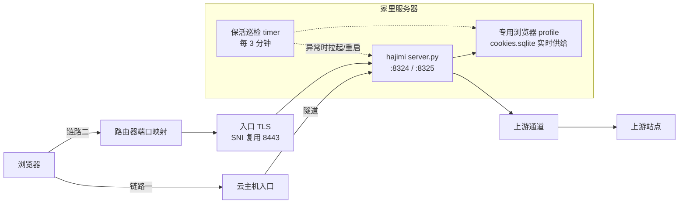

# hajimi-web

**哈吉米网页版 · 自托管网关** —— 把哈吉米网页版完整搬到自己的域名下：对话、流式输出、文件上传、生图，全部照常工作，浏览器打开就能用。

> 纯 Python 标准库实现，零第三方依赖，单个 `server.py` 跑起来就是一整套转发服务。

## 与"转 API"类项目的区别

| | 转 API 类项目 | 本项目 |
|---|---|---|
| 使用方式 | 暴露 OpenAI 兼容接口，接客户端 | **完整网页 UI 原样透传**，浏览器直接用 |
| 会话管理 | 手动贴 cookie / cookie 池 | 实时读取专用浏览器 profile，自动跟随上游轮换 |
| 流式协议 | 重新实现报文转换 | 原样透传上游流式通道，官方前端自己解析 |
| 部署形态 | 单服务 | 可选双链路（中转 + 直连） |

适用场景：给不方便直连上游的设备（旧电脑、平板、公司机器）提供一个"打开就能用"的入口；或把入口域名的控制权握在自己手里。

## 架构



## 核心特性

- **完整 UI 透传**：会话建立、流式通道、多模态上传、生图全部照常
- **请求签名**：服务端实时计算 `SAPISIDHASH` 授权头，会话正常落库
- **Cookie 实时供给**：从专用浏览器 profile 的 `cookies.sqlite` 读取（5 秒缓存），上游时间戳 cookie 的周期轮换自动跟随，无需手动维护 cookie 文本
- **全套客户端头转发**：`x-goog-*`（客户端身份 + 上传协议）原样转发
- **内容安全策略治理**：重写上游 CSP 为可用白名单，注入 setter 补丁兼容前端动态资源加载
- **双链路**：云主机隧道中转 + 入口 SNI 复用直连（家宽全速，零路由器改动加新站点）
- **访问控制**：口令登录 + HMAC token（30 天有效期）
- **资源缓存**：静态资源本地缓存目录，二次加载飞快

## 快速开始

```bash
# 1. 准备一台能访问上游站点的机器 + 一个已登录哈吉米的专用浏览器 profile
# 2. 配置环境变量（见 .env.example）
export MIRROR_DOMAIN="hajimi.example.com"         # 你的域名
export HAJIMI_PWD="your-access-password"          # 访问口令
export FIREFOX_PROFILE="/path/to/firefox-gemini"  # 专用浏览器 profile 路径
export UPSTREAM_PROXY="http://127.0.0.1:7890"     # 上游通道

# 3. 启动
python3 server.py                                 # 监听 127.0.0.1:8322

# 4. 前面随便挂 nginx / Caddy / 隧道，把 MIRROR_DOMAIN 的流量引过来即可
```

systemd / Caddy / 隧道示例见 [`deploy/`](deploy/)。

## 配置项

| 环境变量 | 默认值 | 说明 |
|---|---|---|
| `MIRROR_DOMAIN` | `hajimi.example.com` | 入口域名（用于 Cookie 域与签名 origin） |
| `MIRROR_PORT` | `8322` | 监听端口 |
| `MIRROR_CACHE` | `./cache` | 静态资源缓存目录 |
| `HAJIMI_PWD` | 无 | 访问口令（未设置则不启用鉴权） |
| `FIREFOX_PROFILE` | `/home/admin/.mozilla/firefox-gemini` | 专用浏览器 profile（凭据来源） |
| `UPSTREAM_PROXY` | `http://127.0.0.1:7890` | 上游通道地址 |
| `DIRECT_TLS_PORT` | `8322` | 直连入口端口（可选，默认关闭） |
| `DIRECT_TLS_CERT` / `DIRECT_TLS_KEY` | `certs/*.pem` | 直连入口证书 |

## 重要说明

- **凭据安全**：profile 由专用浏览器实例持有（建议 `-no-remote` 独立 profile 常驻），浏览器保持登录即持续续签时间戳 cookie；本服务只读 `cookies.sqlite`，不写不碰浏览器
- **掉登录几秒自愈是正常现象**：上游每 15~20 分钟轮换一次时间戳 cookie，轮换真空窗内少数请求会被判未登录，新值落盘后自动恢复（详见 docs/LESSONS.md §4）
- **合规风险自负**：本项目基于对上游网页会话的观察实现，上游可能随时更改协议或限制账号；请仅用于个人用途，勿高频滥用

## 文档

- [踩坑笔记 LESSONS.md](docs/LESSONS.md) —— 请求签名、CSP 治理、轮换真空窗、上传协议、凭据保活闭环设计的完整还原过程

## License

MIT
